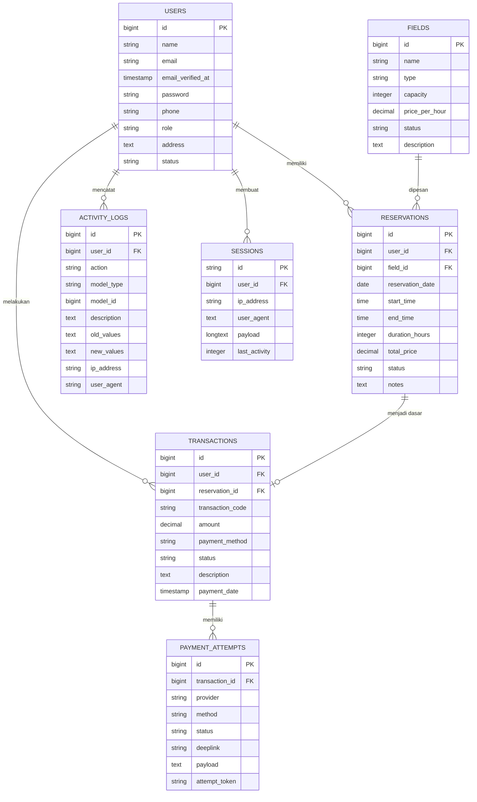

# ERD (Entity Relationship Diagram)

Dokumen ini disusun berdasarkan migrasi database yang ada di folder database/migrations serta skema SQL di database/SCHEMA.sql.

## Ringkasan tabel database

### 1. Tabel utama bisnis

#### users
- id (PK)
- name
- email (unik)
- email_verified_at
- password
- phone
- role
- address
- status
- remember_token
- created_at
- updated_at

#### fields
- id (PK)
- name
- type
- capacity
- price_per_hour
- status
- description
- created_at
- updated_at

#### reservations
- id (PK)
- user_id (FK -> users.id)
- field_id (FK -> fields.id)
- reservation_date
- start_time
- end_time
- duration_hours
- total_price
- status
- notes
- created_at
- updated_at

#### transactions
- id (PK)
- user_id (FK -> users.id)
- reservation_id (FK -> reservations.id, nullable)
- transaction_code (unik)
- amount
- payment_method
- status
- description
- payment_date
- created_at
- updated_at

#### payment_attempts
- id (PK)
- transaction_id (FK -> transactions.id)
- provider
- method
- status
- deeplink
- payload
- attempt_token
- created_at
- updated_at

#### activity_logs
- id (PK)
- user_id (FK -> users.id)
- action
- model_type
- model_id
- description
- old_values
- new_values
- ip_address
- user_agent
- created_at
- updated_at

### 2. Tabel pendukung Laravel / sistem

#### password_reset_tokens
- email (PK)
- token
- created_at

#### sessions
- id (PK)
- user_id (FK -> users.id, nullable)
- ip_address
- user_agent
- payload
- last_activity

#### cache
- key (PK)
- value
- expiration

#### cache_locks
- key (PK)
- owner
- expiration

#### jobs
- id (PK)
- queue
- payload
- attempts
- reserved_at
- available_at
- created_at

#### job_batches
- id (PK)
- name
- total_jobs
- pending_jobs
- failed_jobs
- failed_job_ids
- options
- cancelled_at
- created_at
- finished_at

#### failed_jobs
- id (PK)
- uuid (unik)
- connection
- queue
- payload
- exception
- failed_at

## Relasi utama

- users 1-N reservations
- users 1-N transactions
- users 1-N activity_logs
- users 1-N sessions
- fields 1-N reservations
- reservations 1-0..1 transactions
- transactions 1-N payment_attempts

## Diagram ERD Mermaid

## Catatan implementasi

- reservations.duration_hours dan reservations.total_price dihitung saat pembuatan reservasi.
- transactions.transaction_code dibuat secara otomatis oleh aplikasi.
- payment_attempts.payload disimpan dalam format JSON/text.
- activity_logs digunakan untuk mencatat aktivitas pengguna dan perubahan data.
